# Batteries card

The **Battery Monitor Card** and **Battery Monitor Mini Card**, served by System Hub for its Batteries module. The card types are those of Battery Monitor (`custom:battery-monitor-card`, `custom:battery-monitor-mini-card`), so dashboards made with it keep working once Battery Monitor is removed.

Add it from the dashboard (**Add card → Battery Monitor Card**) or in YAML:

```yaml
type: custom:battery-monitor-card
```

| Option | Default | Description |
|---|---|---|
| `entity` | Auto | The System Hub **Low batteries** sensor; found automatically |
| `title` | `Batteries` | Card title |
| `columns` | `1` | Number of battery columns (1–3); a card too narrow for them shows fewer, each at least 160 px wide |
| `only_low` | `false` | Show only the batteries below the threshold or unavailable |
| `hide_when_ok` | `false` | Hide the whole card when every battery is above the threshold and available (always shown while editing the dashboard) |
| `notify_button` | `true` | Bell button in the header that presses System Hub's **Notify now** button: it turns while sending, then shows a check mark, or the reason in its tooltip when it fails; disabled while the button is unavailable |
| `popup` | `true` | Full screen button in the header |
| `expanded` | `false` | Lay the full screen view out in the card itself (by room, by type, by replacement date, what to replace, next replacement); no full screen button then |
| `csv_button` | `true` | **Export CSV** button in the full screen view and the expanded card |
| `battery_models` | — | The battery type of every device of a model: `Hue dimmer switch: CR2450` |
| `battery_types` | — | The type of one battery, by battery entity: `sensor.remote_battery: 2× AAA` |
| `language` | Auto | Force language: `en`, `fr`, `de`, `es`, `it`, `nl`, `pt`, `pl`, `ro`, `da`, `sv`, `bg`, `ru`, `uk`, `hu`, `sk`, `cs`, `sl`, `lv`, `el`, `sr` or `sr-Latn` |

Tap a battery to open its details.

## Mini card

A compact card for a half-width column: the header with its status and **Notify now** button, and only the batteries needing attention. The detail button (top right) shows the full card; a click outside brings the compact view back. Same options and editor:

```yaml
type: custom:battery-monitor-mini-card
```

## Full screen

The **full screen** button shows every battery grouped **by room**, **by battery type** or **by replacement date**, with **To replace** (how many batteries of each type to buy) and **Next replacement** (the first battery the measured drain takes to the threshold). **Export CSV** downloads every battery (room, type, level, status, drain, days left, replacement date). It closes with its button, Escape, a click outside, or the back button on a phone.

## Battery types

System Hub already gives each battery its type: the one set in **Settings → Devices & services → System Hub → Configure → Battery types** (per battery or per device model), otherwise [Battery Notes](https://github.com/andrew-codechimp/HA-Battery-Notes). The types set in the card editor (**Battery types by model**, **Battery types by battery**) still apply on top, for that card only; **Configure → Import from Battery Monitor** brings those of existing cards into System Hub. `2× AA` (or `2x AA`, `AA x2`) counts two batteries; batteries without a type are grouped under **Unknown type**.

```yaml
type: custom:battery-monitor-card
battery_models:
  Hue dimmer switch: CR2450
battery_types:
  sensor.remote_battery: 2× AAA
```

## Screenshots

A battery due for replacement blinks its icon (honours `prefers-reduced-motion`):

| Light | Dark |
|---|---|
| 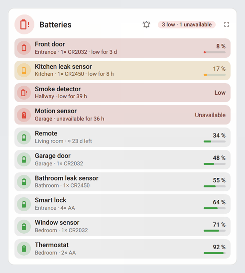 | 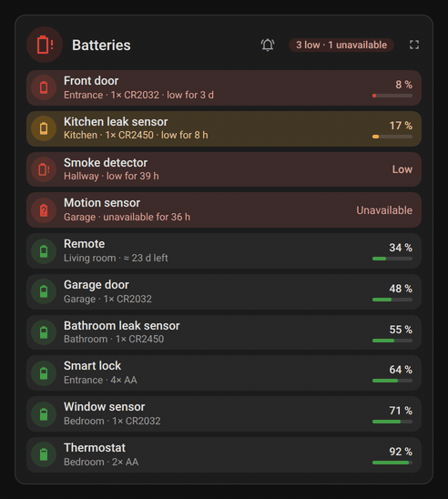 |

| Every battery | Low batteries only |
|---|---|
| 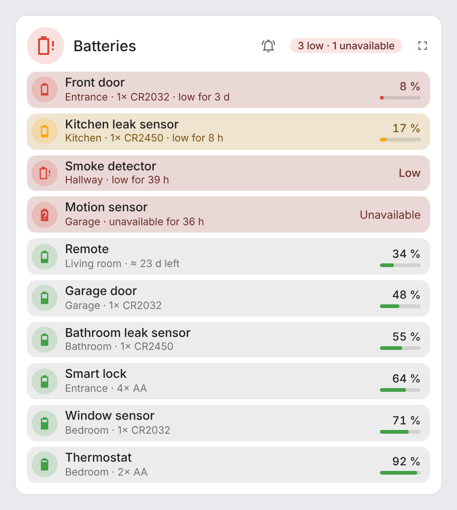 | 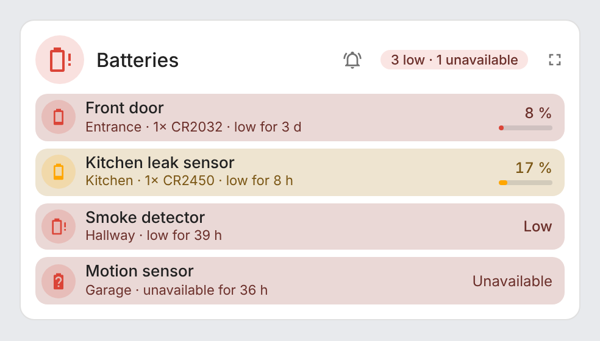 |
| 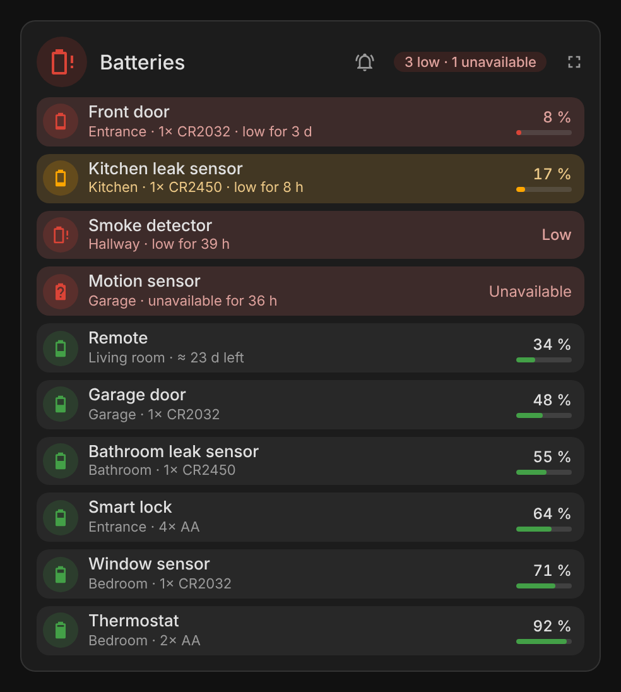 | 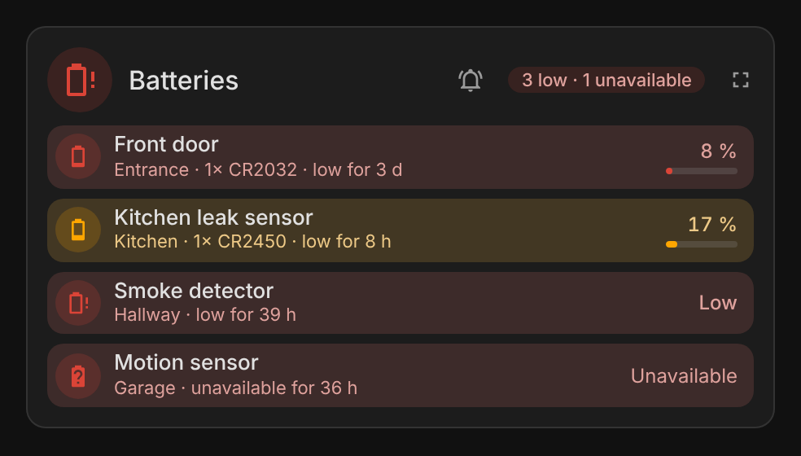 |

| Mini card | Dark |
|---|---|
| 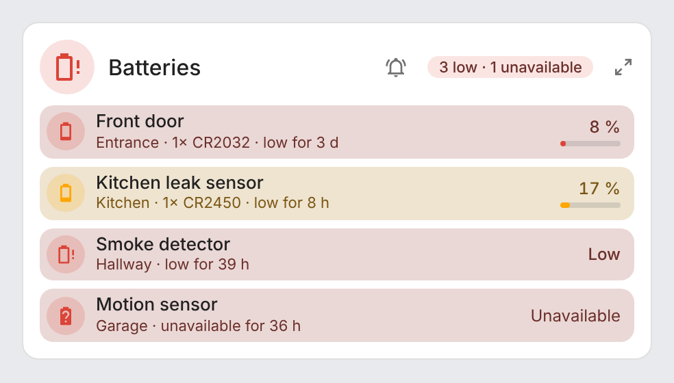 |  |

| Full screen, by replacement date | Dark |
|---|---|
| 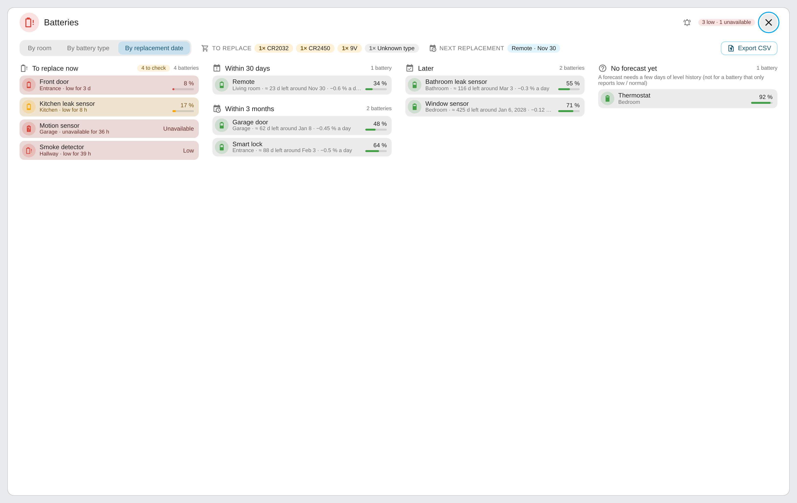 | 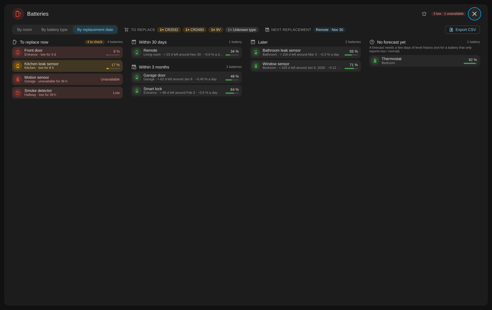 |

| Full screen, by room | Full screen, by battery type |
|---|---|
| 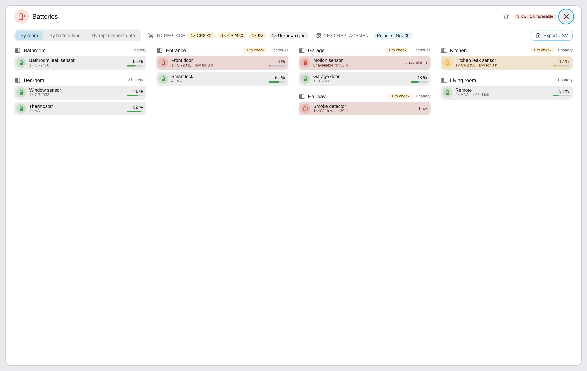 | 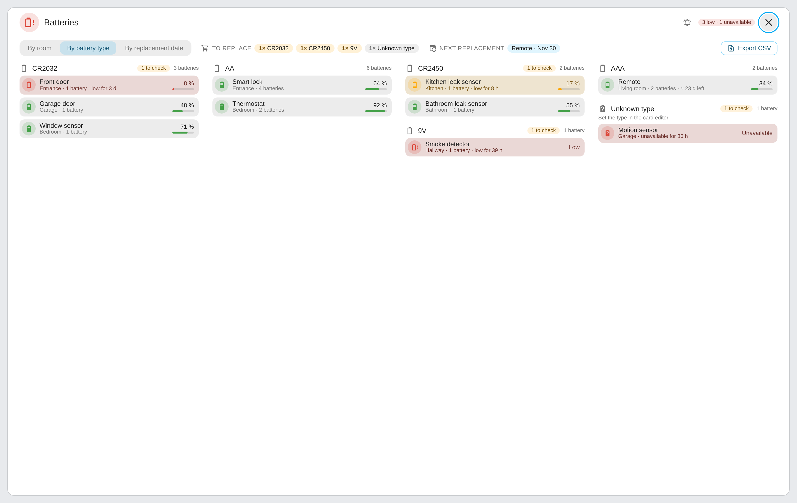 |
| 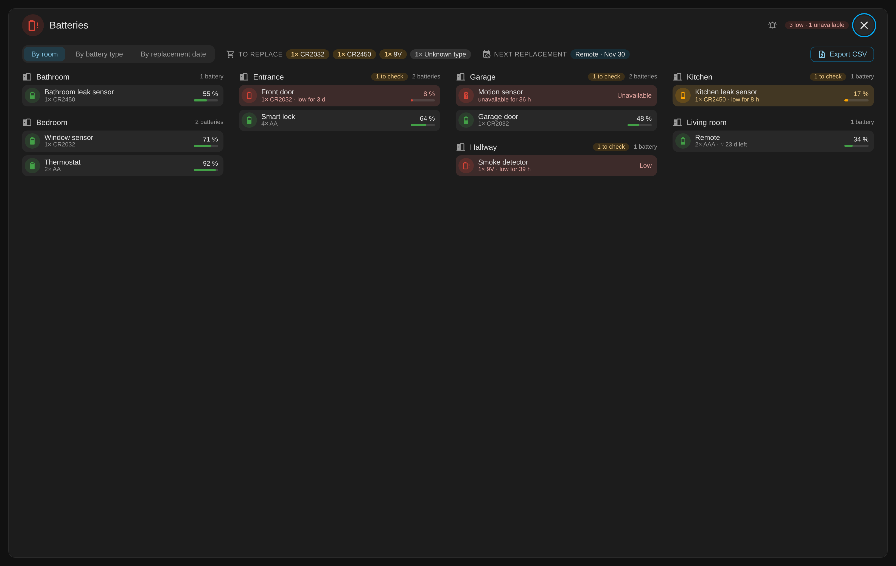 | 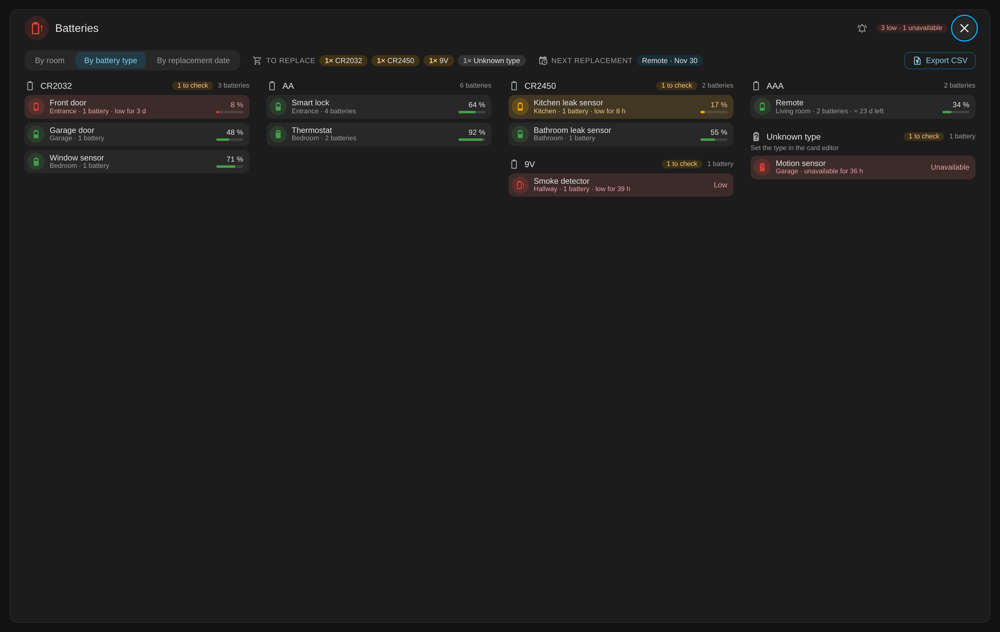 |

| Phone, by room | Phone, by battery type |
|---|---|
| 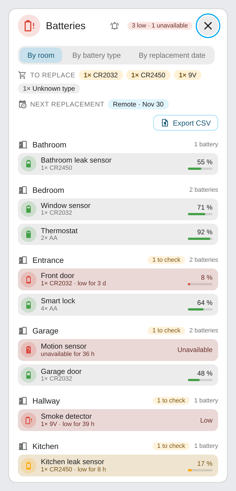 | 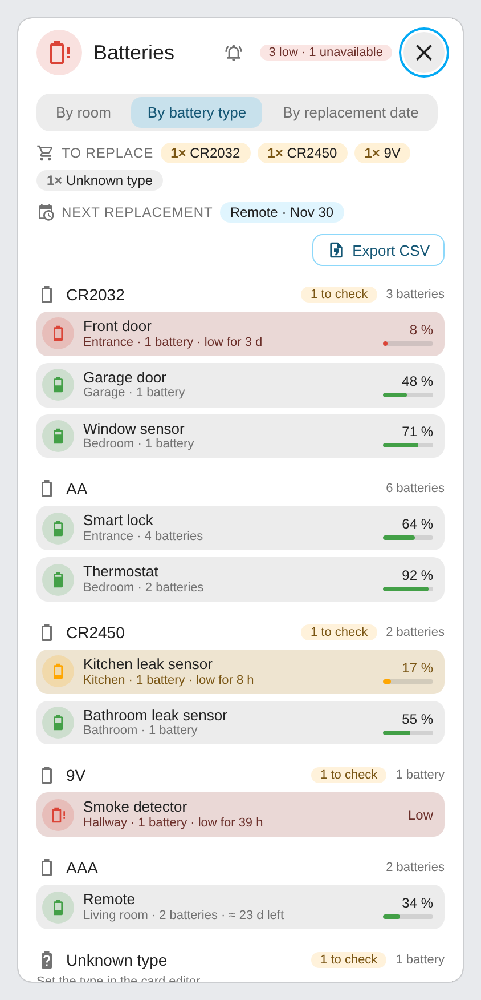 |
| 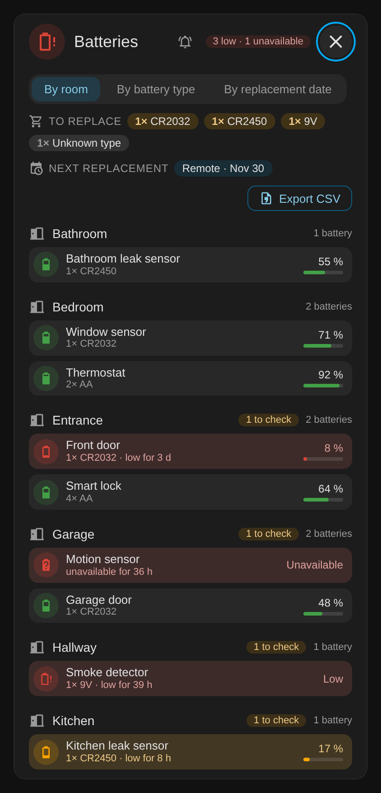 | 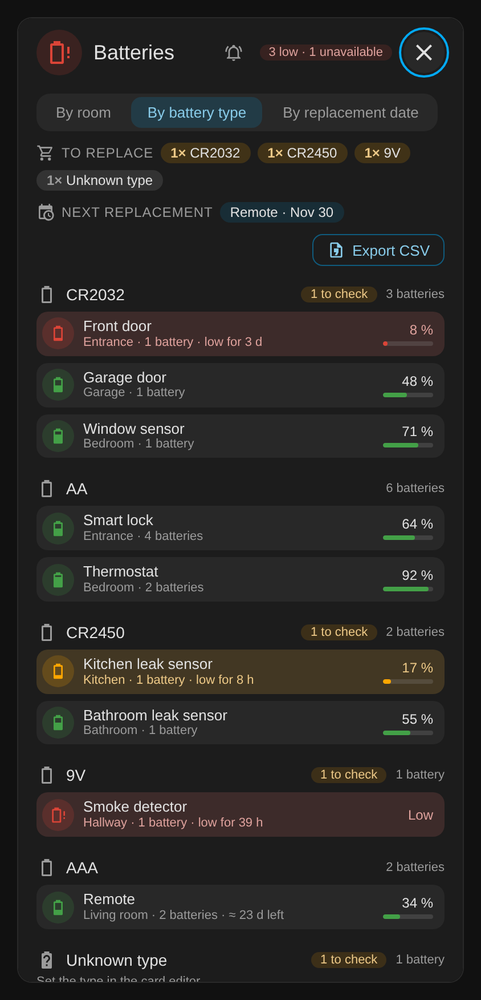 |
