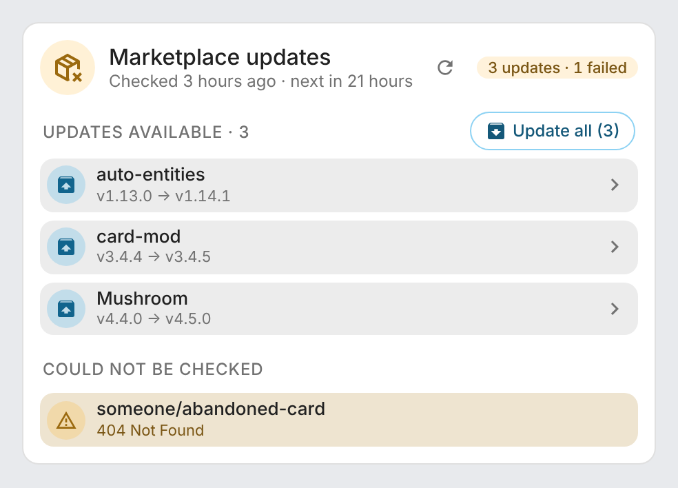
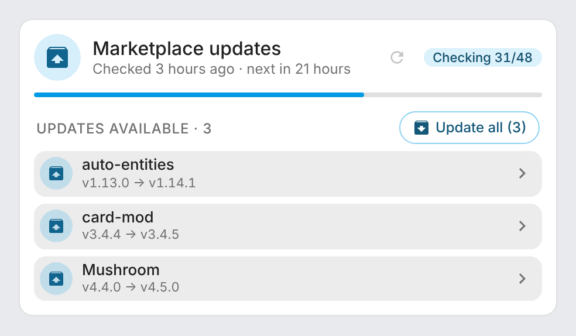
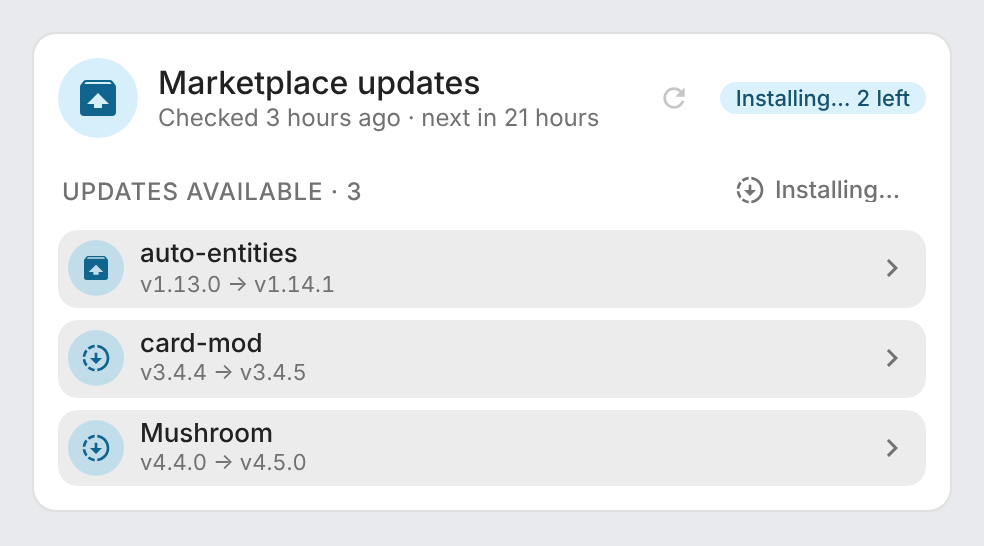
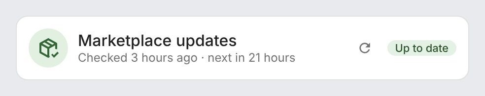
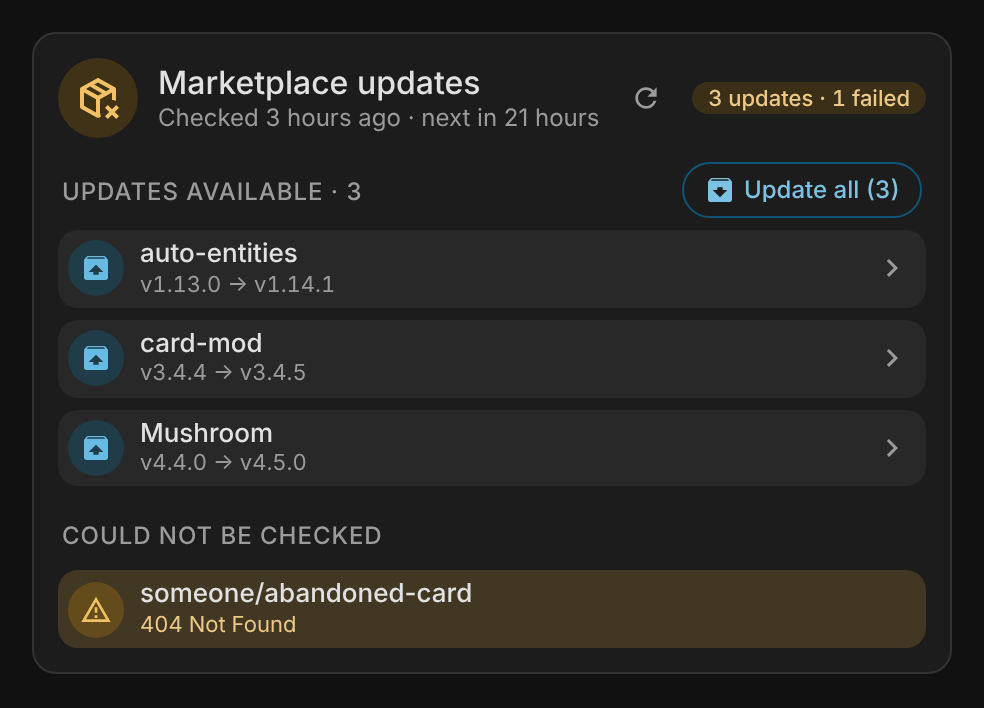
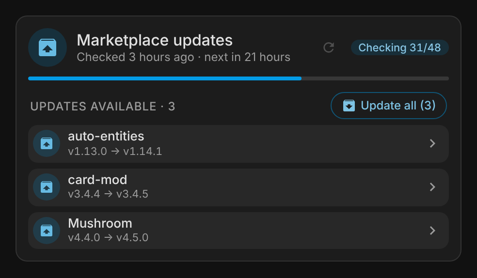
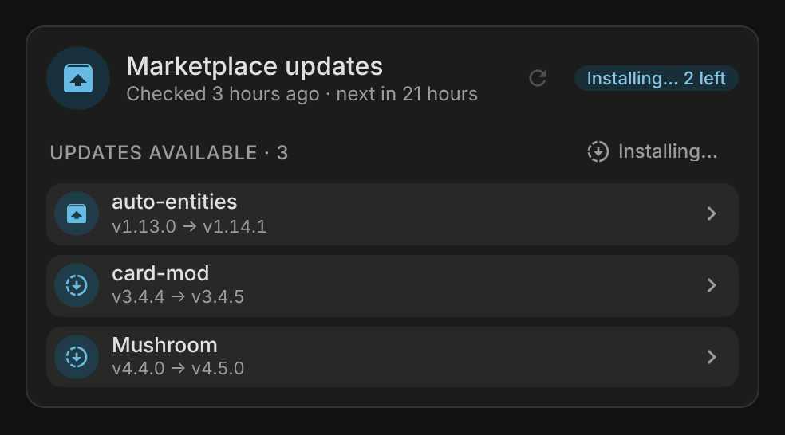
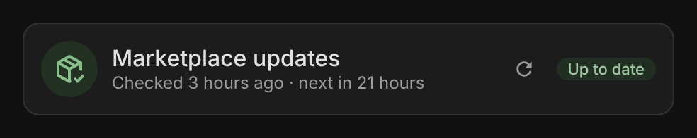

# Marketplace Refresh Card

The card of System Hub's **Marketplace** module, ported from [ha-marketplace-refresh](https://github.com/juju35/ha-marketplace-refresh): same element name, options and look, so a dashboard keeps working once the module replaces the old integration. System Hub serves it with its other cards: no separate install. Add it from the card picker, or:

```yaml
type: custom:marketplace-refresh-card
```

| Updates available | Checking | Installing | Up to date |
|---|---|---|---|
|  |  |  |  |
|  |  |  |  |

- **Header**: status (up to date, *n* updates, *n* failed, checking *done/total*, error), when the last check ran and when the next automatic one is due, and the **Check for updates** button
- **Progress bar** while a check runs
- **Few GitHub requests left**: under 1,500, a line with the number left and when GitHub's limit resets — checks wait for it
- **Updates available** (with their number): the repositories with an update, from the Marketplace's own update entities, with the installed and new version, hidden when there is none. A row opens the update entity, to install it or read the release notes
- **Update all (*n*)**: installs every update listed, one after the other, after a confirmation at the top of the card (administrators only). The rows being installed and the number left show the progress
- **Could not be installed**: the updates that failed, with the error
- **Could not be checked**: the repositories the last check couldn't fetch (and, without a GitHub account connected, the ones added from a link, with a line saying why), and the error of a check that failed

Every option is in the visual editor:

| Option | Default | Description |
|---|---|---|
| `entity` | found automatically | The Marketplace **Status** sensor (`sensor.system_hub_marketplace_status`); its **Last check** sensor or **Check for updates** button lead to it, and an entity that no longer exists (from the old integration, say) falls back to it |
| `title` | Marketplace updates | Card title |
| `show_updates` | `true` | Updates available |
| `show_failed` | `true` | Repositories that couldn't be checked, and the error of a failed check |
| `check_button` | `true` | **Check for updates** button in the header |
| `install_button` | `true` | **Update all** button on the updates available (administrators only) |
| `hide_when_ok` | `false` | Hide the card while everything is up to date (it shows while checking, with an update or an error, and always while editing the dashboard) |
| `language` | Home Assistant's | `en`, `fr`, `de`, `es`, `sr`, `sr-Latn`, `it`, `nl`, `pt`, `pl`, `ro`, `da`, `sv`, `bg`, `ru`, `uk`, `hu`, `sk`, `cs`, `sl`, `lv` or `el` |

## Entities and actions used

The card reads the Marketplace module's sensors, told apart by their translation key (`marketplace_status`, `marketplace_last_check`, button `marketplace_check_updates`) so renamed entity IDs keep working, and only System Hub's (the other modules have a status too), plus the Marketplace's own update entities. **Check for updates** presses `button.system_hub_marketplace_check_updates`; **Update all** calls `system_hub.marketplace_install_updates` with the update entities listed.

Screenshots: `python scripts/screenshots_marketplace.py` (mock data, frozen clock; repository pictures are not fetched).
