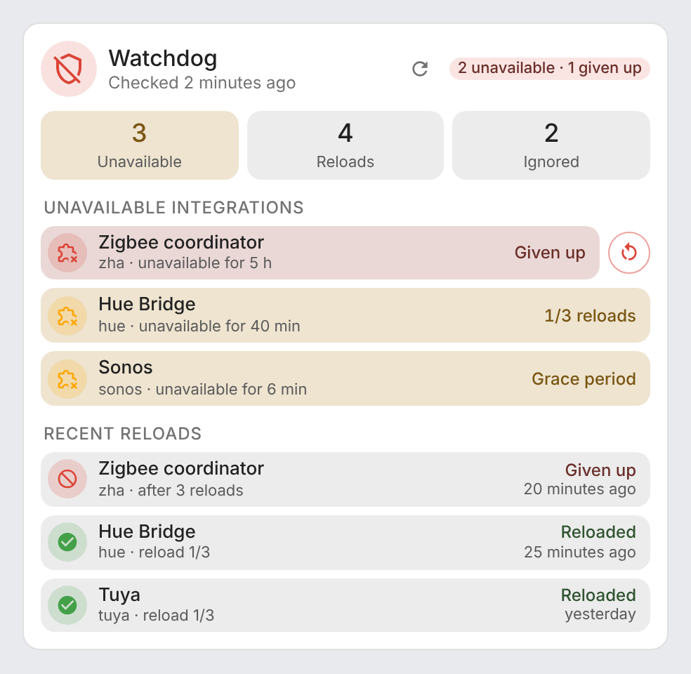
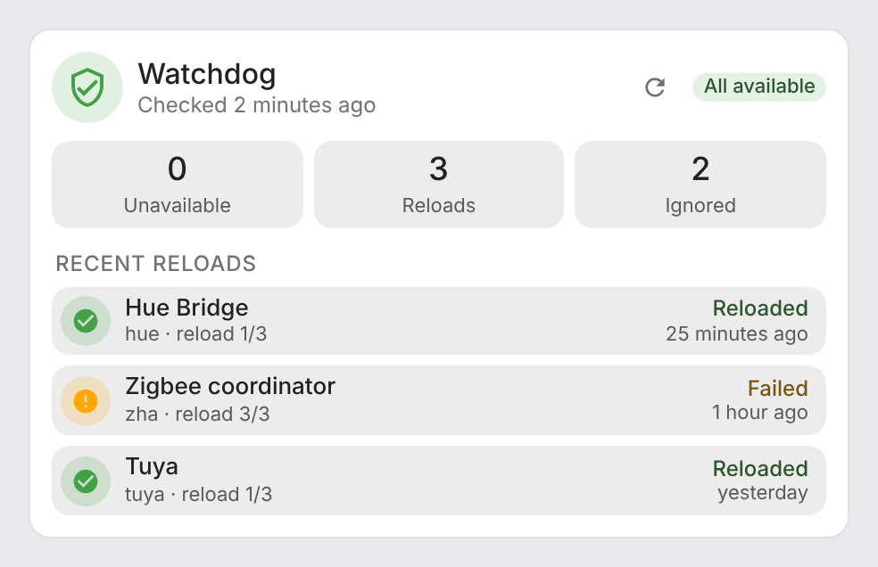
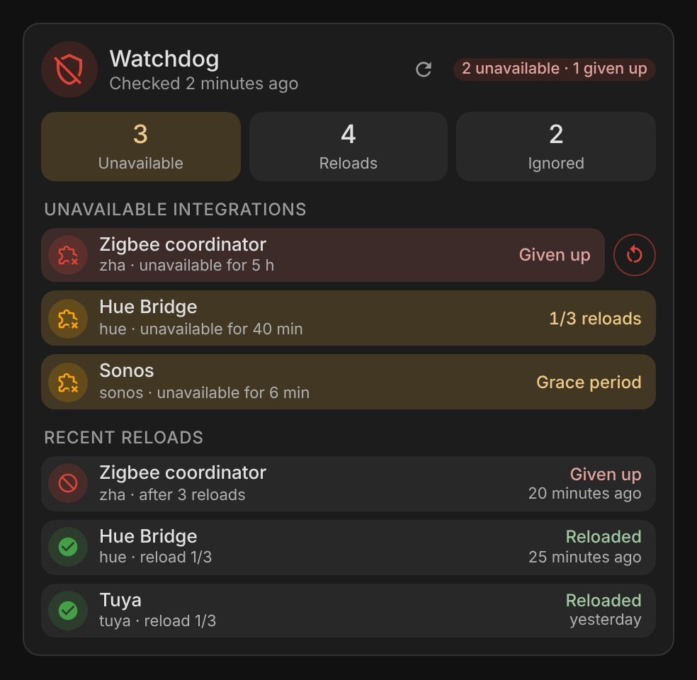
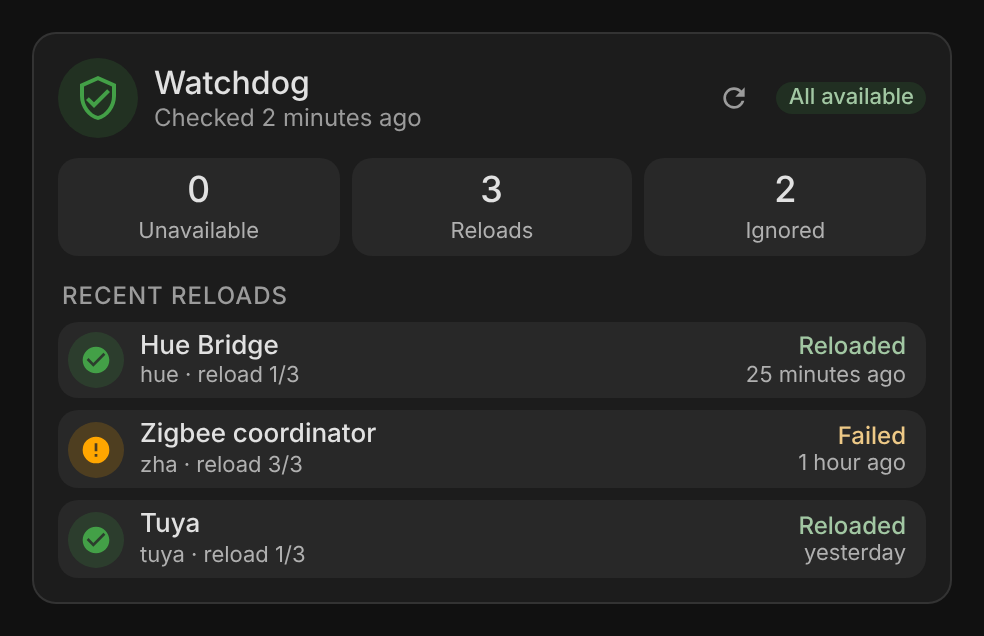
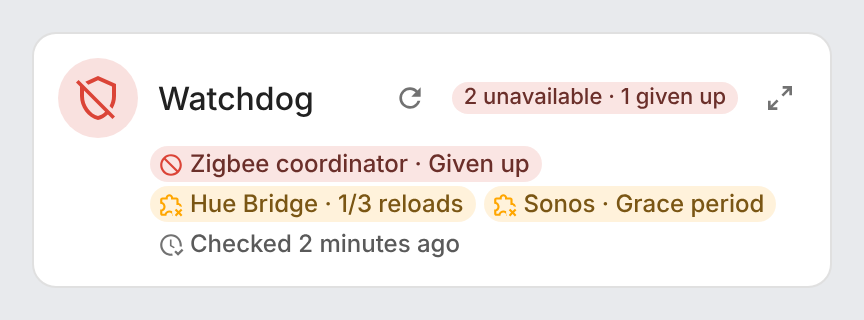
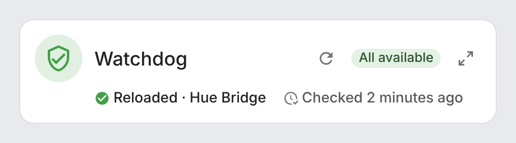
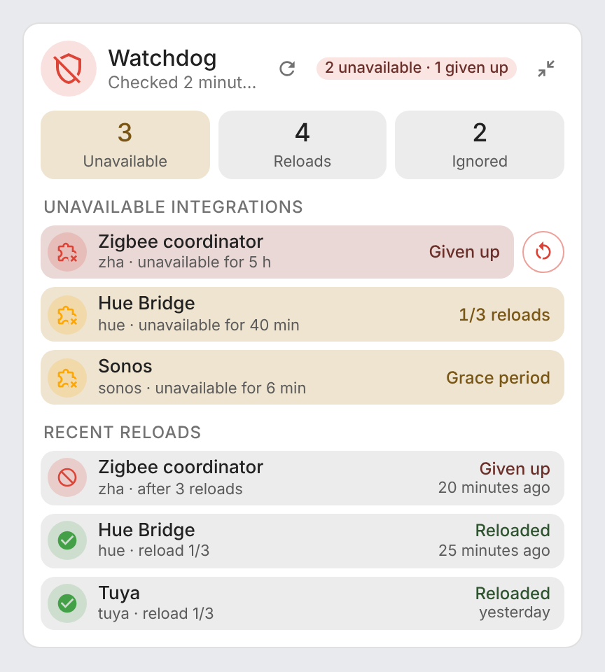
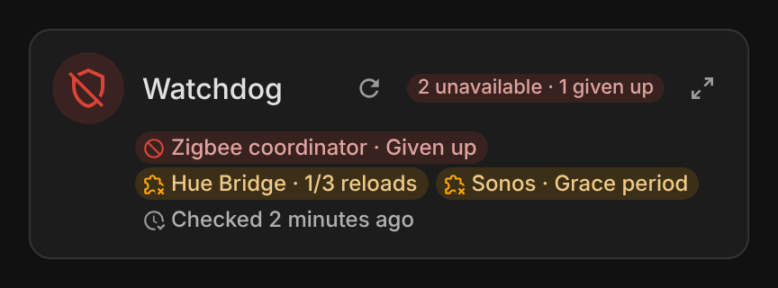
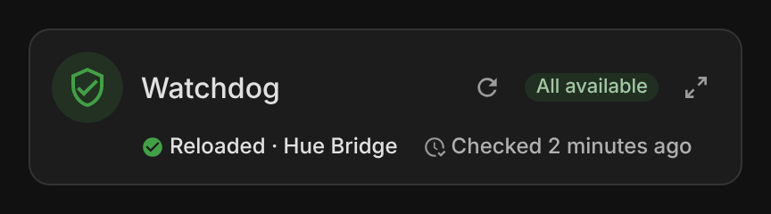
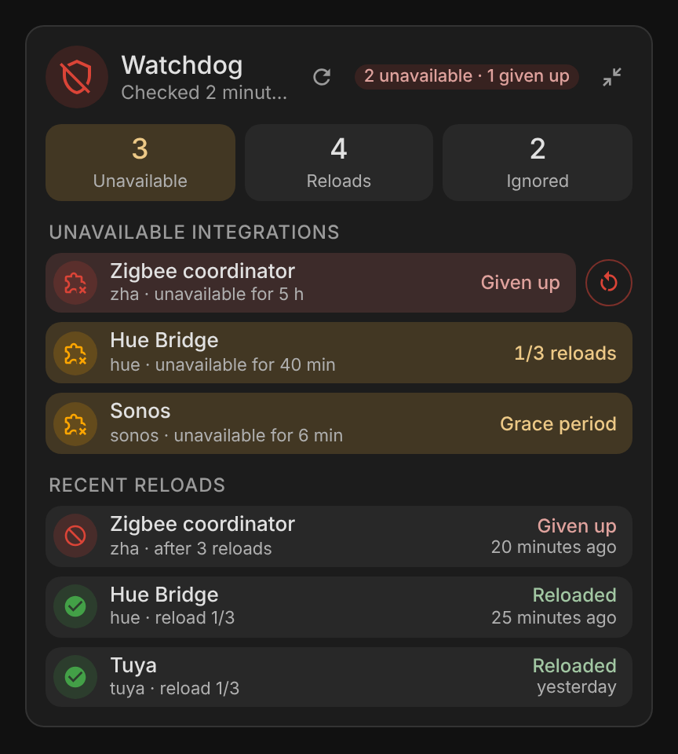

### Watchdog card

System Hub serves the **Watchdog Card** (ported from Integration Watchdog) with its other cards: no separate install. It keeps the card types of Integration Watchdog, so dashboards that used them keep working once Integration Watchdog is removed (a card still pointing at its old sensor finds System Hub's on its own). Add it from the card picker (**Watchdog Card (System Hub)**), or:

```yaml
type: custom:integration-watchdog-card
```

| Unavailable integrations | Everything available |
|---|---|
|  |  |
|  |  |

- **Header**: status (all available, *n* unavailable, *n* given up, checking…), time of the last check and the **Check now** button. On a narrow card the status takes a second line, shortens, then keeps only its coloured dot, with the text on hover. In a Sections view the card takes at least 8 columns
- **Summary**: unavailable integrations, reloads since Home Assistant started, ignored integrations (listed on hover)
- **Unavailable integrations**: for each one, how long it has been down and its reloads (*1/3 reloads*), *Grace period* before the first one, *Given up* once the limit is reached
- **Recent reloads**: the last attempt of each integration (reloaded, failed or given up), newest first, with the attempt and how long ago. The history is saved, so it survives a restart
- For an administrator, a row opens the integration's page in **Settings** on its entry, to reload it by hand or read its logs (other users can't open Settings, so their rows are not clickable). Integration logos come from the Home Assistant brands
- For an administrator, an integration given up gets a **Try again** button next to its row: it runs the `system_hub.watchdog_reset` action (start over and reload now)

It reads the Watchdog module's entities (`sensor.system_hub_watchdog_unavailable_integrations`, `sensor.system_hub_watchdog_last_reload`, `sensor.system_hub_watchdog_last_check`, `button.system_hub_watchdog_check_now`), found by their translation keys, so renamed entities are still found. Every option is in the visual editor:

| Option | Default | Description |
|---|---|---|
| `entity` | found automatically | The **Unavailable integrations** sensor of System Hub |
| `title` | Watchdog | Card title |
| `show_stats` | `true` | Summary tiles |
| `show_unavailable` | `true` | Unavailable integrations |
| `show_history` | `true` | Recent reloads |
| `history_count` | `5` | Recent reloads shown (one per integration), from 1 to 20 |
| `check_button` | `true` | **Check now** button in the header. It presses the button entity, so any user who sees the card can run a check (only the `system_hub.watchdog_check` action is limited to administrators) |
| `hide_when_ok` | `false` | Hide the card while every integration is available (always shown while editing the dashboard) |
| `language` | Home Assistant's | `en`, `fr`, `de`, `es`, `it`, `nl`, `pt`, `pl`, `sr`, `sr-Latn`, `ro`, `da`, `sv`, `bg`, `ru`, `uk`, `hu`, `sk`, `cs`, `sl`, `lv` or `el` |

#### Watchdog mini card

`custom:integration-watchdog-mini-card` shows the essentials on two lines, for a compact dashboard: the icon, title, **Check now** button and status, then a chip per unavailable integration (*Hue Bridge · 1/3 reloads*, *Zigbee · Given up*), or the last reload while everything is available, and the time of the last check. Search for **Watchdog Mini Card (System Hub)** when adding a card, or in YAML:

```yaml
type: custom:integration-watchdog-mini-card
```

| Unavailable integrations | Everything available | Zoomed in |
|---|---|---|
|  |  |  |
|  |  |  |

- The **detail** button (top right) switches the card to the full Watchdog card, with the same options, and back, as does a click anywhere else on the page
- For an administrator, an integration's chip opens its page in **Settings**, on its entry; for other users, a chip opens the sensor
- In a Sections view the card takes 6 columns by default, its minimum; on a narrow card the icon gives way and the status keeps only its coloured dot

It takes every option of the full card (they set its detail view, `hide_when_ok` and `check_button` apply to both views), plus:

| Option | Default | Description |
|---|---|---|
| `zoom` | `true` | **Detail** button showing the full card. `false` removes it |

The screenshots are made by `python scripts/screenshots_watchdog.py`.
